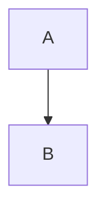

## 结论

这篇是编辑器系列的第三篇，接在 [停手三秒就自动存了](/p/editor-autosave) 和 [Markdown 渲染器凭什么敢直接处理 `<script>`](/p/editor-markdown-xss) 后面。前两篇一个管内容不丢，一个管预览不执行脚本，这篇管第三件麻烦事：把 Monaco 当外壳挂上去以后，换行符怎么把我精心维护的偏移量彻底搅乱。

先把结论压成三句。第一句：**Monaco 对一个空文档，`model.getEOL()` 恒返回 `'\r\n'`（CRLF），哪怕同一个时刻 `getEndOfLineSequence()` 已经是 LF。** 这两者不是一回事，前者是「当前实际用的换行串」，后者是「记录在 model 上的序列枚举」，空文档里它们会分叉。第二句：**`EndOfLineSequence.LF === 0`，而 `EndOfLinePreference.LF === 1`，两个枚举的字面值正好相反**，任何写死数字的写法都有一半概率设反。第三句：这套编辑器真正的数据源一直是那个影子 `textarea`，Monaco 只是挂在外面的壳，所以一旦 Monaco 内部的换行和 textarea 的换行不一致，所有基于偏移的工具栏操作都会错位。

这三条里最容易低估的是第一条。空文档在写作场景里不是边角情况——每篇新文章都是从空文档开始敲的，而「第一次插入」又往往不是逐字敲，是点一下工具栏模板、粘贴一段现成文字。恰恰是这些批量插入的路径，会把 CRLF 一次性带进整篇正文。等发现的时候，字数统计、diff、正则匹配全被看不见的 `\r` 带偏，而肉眼在渲染后的预览里什么异常都看不到。

数据源这件事也值得在开头钉死。保存、自检、草稿读取，全部读 `inputEl.value`，一共三处，没有第四处。Monaco 的存在感被压到最低：它只负责显示和接收键盘输入，它的 `getValue()` 在每次内容变化时整篇写回 `inputEl.value`，仅此而已。这个架构决定了「偏移错位」的爆炸半径——它不会让内容丢失，不会让保存失败，只会让工具栏和光标这些建立在偏移之上的交互变得诡异。正因为不致命，它很容易被当成小毛病拖着，而拖着拖着就会有人用写死数字去「修」，于是引出第二条坑。

三个数字都来自本站 2026-11-22 的实际改动，代码在 `public/editor.html`，commit 是 `82e4b84`（Monaco 主体）和 `877d1dc`（工具栏 mermaid 模板 + 换行 LF 归一）。我没有引入任何第三方封装库，Monaco 只挂在 `/editor` 这一个页面，CDN 锁死在 `monaco-editor@0.52.2`。下面每一段代码都能在 `public/editor.html` 的对应行号里找到原型，贴出来的是删掉无关分支后的版本；没有测过的判断我会单独标出来，不当成结论卖。

## 一、现象：工具栏一插模板，光标就偏一行

第一个症状出现在工具栏的 mermaid 模板按钮上。这个按钮是 `877d1dc` 那次一起加的，点一下往光标处插一段三行的围栏代码：

```text

```

插完预览是好的，mermaid 照常渲染（`securityLevel:'strict'`，和它同批上线），但光标没有落在模板末尾，而是往上飘了一行；紧接着再点一次别的按钮，插入位置就落在了上一行的中间。这个反差一开始把我带偏了——预览正确说明 Markdown 解析没问题、内容没丢，那出错的只能是「光标位置」这件看起来很小的事。我把注意力全放在选区设置上，反复看 `edReplace` 里那段 `setSelection`，怎么读都觉得行列算得没毛病。

插入走的是适配层的 `edReplace`，代码在 `public/editor.html:383`：

```js
function edReplace(text, s, e, selectFrom, selectTo) {
  if (monaco) {
    const model = monaco.getModel();
    const st = model.getPositionAt(s);
    const en = model.getPositionAt(e);
    monaco.executeEdits('toolbar', [
      { range: new monacoApi.Range(st.lineNumber, st.column, en.lineNumber, en.column), text },
    ]);
    if (selectFrom != null) {
      const a = model.getPositionAt(selectFrom);
      const b = model.getPositionAt(selectTo == null ? selectFrom : selectTo);
      monaco.setSelection(new monacoApi.Range(a.lineNumber, a.column, b.lineNumber, b.column));
    }
    monaco.focus();
  } else {
    inputEl.setRangeText(text, s, e, 'end');
    if (selectFrom != null) inputEl.setSelectionRange(selectFrom, selectTo == null ? selectFrom : selectTo);
    inputEl.focus();
  }
  onInput();
}
```

这段代码有个前提：`s` 和 `e` 是 textarea 口径的偏移（UTF-16 code unit），而 `getPositionAt` 收的是 Monaco model 口径的偏移。两者要相等，必须满足一件事——两份文本逐字节一致，尤其是换行符必须逐字节一致。这个前提在空文档上第一次被打破，于是整条链从第一行就开始歪。

走 `else` 分支（Monaco 没挂载）时，同一段逻辑完全正常：`inputEl.setRangeText` 直接吃 textarea 原生偏移，不存在两层文本不一致的问题。也就是说这个 bug 只在 Monaco 挂载成功时出现——降级路径反而是干净的那条。这一点后来成了定位问题的关键线索：同一个按钮，挂了 Monaco 会错，不挂就对，那问题必然出在「Monaco 与 textarea 之间的映射」上，而不是工具栏逻辑本身。

## 二、第一反应是数错偏移，其实错在换行

我最初怀疑自己数错了行数，拿着 `getPositionAt(s)` 和 `getOffsetAt(pos)` 来回对拍，怀疑是 UTF-16 把 emoji 算成两个 code unit 导致的。这个方向后来证明是错的：中文标题和 emoji 那条路径没有出问题，偏偏只在插入多行文本、且文档原本是空的时候出问题。把插入后的 `model.getValue()` 打印出来，才看见每个换行位置躺着的是 `\r\n` 而不是 `\n`。

根因在 `executeEdits` 内部：它用 `model.getEOL()` 来规范化插入文本里的换行。空文档的 `getEOL()` 恒为 `'\r\n'`，所以第一次插入三行 mermaid 模板，三行之间就被塞进了 `\r`。而 textarea 那一侧从来都是 `\n`，库里存量文章也都是 `\n`（早年编辑器留下的 CRLF 是另一路，后面单独说）。于是同一个「第 2 行行首」，两边的偏移开始分叉。

这里要补一句术语。偏移是 UTF-16 code unit 计数：一个普通汉字占一个 code unit，一个 emoji 占两个，而一个 `\r\n` 占两个、一个 `\n` 占一个。Monaco 的 `getPositionAt(offset)` 把偏移翻译成「第几行第几列」，`getOffsetAt(position)` 反过来翻译，两者互为逆运算——前提是它们操作的是同一份、换行符完全一致的字符串。一旦 textarea 用 `\n`、model 用 `\r\n`，这两个函数算出来的行列和 textarea 的 `selectionStart` 就再也对不上，而且差值逐行累加，越往后越离谱。

分叉的规律很朴素，每个 `\r\n` 比 `\n` 多一个字符，偏移就多算 1：

| 位置 | textarea（`\n`）偏移 | Monaco（`\r\n`）偏移 | 差值 |
|---|---|---|---|
| 第 1 行末尾 | 11 | 11 | 0 |
| 第 2 行行首 | 12 | 13 | +1 |
| 第 3 行行首 | 20 | 22 | +2 |
| 第 4 行行首 | 23 | 26 | +3 |

这张表里的具体字符数是按那段 mermaid 模板手工推的，用来说明「每个换行差 1、逐行累加」这个规律；我没有在真机上逐个打印过这些偏移量，所以表中数值只到推断为止，能确定的只有差值那一列的递增规律。真正确认过的，是 `getValue()` 里出现 `\r\n`、以及 `inputEl.value.slice(s,e)` 与 Monaco 返回的文本对不上这两件事——它们都能在改动前后的对照里复现。

工具栏里所有需要「取一段文本再改」的操作都吃这个亏。`## `、`> `、`- ` 这类行首前缀往 `edLineStart()` 返回的偏移处插，Tab 键把选中行整体缩进两个空格，撤销/重做后重新算选区，全部依赖偏移和行列的一一映射。换行符一旦多出一个不可见字符，这条映射就从出错那一行起整体平移。四个适配函数各自吃偏移的方式不同，但都建立在同一个假设上：

| 函数 | 拿偏移做什么 | 受 CRLF 影响的环节 |
|---|---|---|
| `edSelection` | `getOffsetAt` 把行列换成偏移 | 选区起止偏移整体平移 |
| `edReplace` | `getPositionAt` 把偏移换成行列 | 插入位置与回设选区错位 |
| `edSetText` | 整篇赋值，不直接吃偏移 | 入口是否归一决定后续是否错位 |
| `edLineStart` | `getOffsetAt` 取当前行行首 | 行首前缀插到错误的行 |

这张表是四个函数在 `public/editor.html` 里的实际职责归纳，不是另造的分类。可以看到真正「吃偏移」的是前两个和第四个，而 `edSetText` 的作用是在最上游把文本洗对——这也解释了为什么修法必须落在 `edSetText` 入口，光在 `edReplace` 里兜是不够的。

## 三、两个枚举，字面值相反

真正把坑挖深的是我第一版修法：既然 `getEOL()` 是 CRLF，那就设成 LF 好了，于是写了 `model.setEOL(1)`。结果越修越糟——插入的多行文本 `\r` 更多了。查 Monaco 的枚举定义才发现，两个名字里都带 `LF` 的常量，字面值是反的：

| 枚举 | `LF` 的值 | `CRLF` 的值 | 用途 |
|---|---|---|---|
| `monacoApi.editor.EndOfLineSequence` | `0` | `1` | `model.setEOL()` 的参数，表示要把 model 设成哪种换行 |
| `monacoApi.editor.EndOfLinePreference` | `1` | `2` | 读值/保存时的偏好，表示按哪种换行解释文本 |

我写的 `setEOL(1)` 落到了 `EndOfLineSequence.CRLF` 上，等于亲手把 model 锁进 CRLF。这里没有类型转换也没有隐式规则，就是两个枚举把 `LF` 摆在了不同的数字上：一个是 0，一个是 1。两个枚举各自内部自洽，跨着用就翻车——这是所有「字面值相反」类 bug 的通病。

为什么库里会存在两个几乎同名的枚举，我没有查 Monaco 的设计文档，这条只到推断为止：一个描述「model 实际存了什么换行」（Sequence，写），一个描述「读出来时按什么偏好解释」（Preference，读），职责不同所以各自编号，编号时又都以自己喜欢的值为先，于是撞出了相反的字面值。这个推断能解释现象，但成因我没有验证过，不当成事实。

唯一稳妥的写法是永远用枚举常量，永远不写裸数字：

```js
// ✓ 用枚举，数字是多少不关心
model.setEOL(monacoApi.editor.EndOfLineSequence.LF);

// ✗ 写死数字：1 在 Sequence 里是 CRLF，在 Preference 里才是 LF
model.setEOL(1);
```

我把这条写进了代码注释，位置在 `public/editor.html:394`，因为这种坑一定会有人（包括几个月后的我）再踩一次。判断依据不是「文档说 0 还是 1」，而是「这个参数的类型是 `EndOfLineSequence` 还是 `EndOfLinePreference`」。写死数字的坏处不只是这次设反——它还会通过一个隐蔽的路径扩散：`setEOL(1)` 让 model 变成 CRLF，下一次 `executeEdits` 又用这个 CRLF 去规范化新插入的多行，于是 `\r` 越来越多，形成正反馈。这才是我说的「越修越糟」的真正机制，不是一次性的写错，是错误被后续操作不断放大。

## 四、三处修法，各堵一类入口

修法落在三个入口上，每个堵一类来源，缺一个都会从别的口子漏回来：

| 入口 | 触发时机 | 修法 | 代码位置 |
|---|---|---|---|
| `executeEdits` | 工具栏、Tab、粘贴等一切插入多行 | 插入后检测并压回 LF | `public/editor.html:396` |
| `edSetText` | 载入草稿、切换文章、整篇赋值 | 入口把存量 CRLF 归一成 LF | `public/editor.html:418` |
| `editor.create` | 页面初始化、空文档第一次建 model | create 后显式 `setEOL` | `public/editor.html:1588` |

第一处是 `edReplace` 里紧跟 `executeEdits` 的那两行：

```js
monaco.executeEdits('toolbar', [
  { range: new monacoApi.Range(st.lineNumber, st.column, en.lineNumber, en.column), text },
]);
/* executeEdits 用 model.getEOL() 规范化换行，而空文档的 getEOL() 恒为 CRLF
   （哪怕 getEndOfLineSequence() 已经是 LF）—— 空文档里第一次插入多行内容会带进 \r。 */
if (model.getEOL() !== '\n') model.setEOL(monacoApi.editor.EndOfLineSequence.LF);
```

用 `model.getEOL() !== '\n'` 当判断条件，而不是无条件 `setEOL`，是为了不把已经是 LF 的正常插入也标成一次 model 改动——少一次改动，就少一次触发 `onDidChangeModelContent` 的机会。这里的固定搭配是「检测实际换行串 + 用序列枚举写回」，两件事分开做，谁都不省。省掉检测，正常的 LF 插入也会走一遍 `setEOL`；省掉枚举，就可能设反。这一行看着短，两个坑同时被它堵住。

第二处在 `edSetText` 入口，处理的是存量文章。库里有早年编辑器留下的 CRLF 正文，它们不经过 `executeEdits`，而是整篇灌进 textarea 和 Monaco：

```js
function edSetText(t) {
  // 存量文章可能是 CRLF（早年编辑器留下的），进来先统一，别再传染出去
  t = String(t || '').replace(/\r\n?/g, '\n');
  if (inputEl.value !== t) inputEl.value = t;
  if (monaco) {
    monoSyncing = true;
    monaco.setValue(t);
    monoSyncing = false;
  }
}
```

正则 `/\r\n?/g` 同时覆盖 `\r\n`（Windows 换行）和落单的 `\r`（老 Mac 换行），两种都归一成 `\n`。这一步放在赋值之前，保证 textarea 和 Monaco 拿到的永远是同一份、同一种换行的文本——数据源一致，偏移就不会漂。`monoSyncing` 这个布尔开关包住 `setValue`，是防止程序自己的整篇赋值又被 `onDidChange` 当成用户输入回灌一遍。

第三处在 `create` 之后、挂监听之前，下一节专门讲。三处合起来覆盖的时间线是：页面初始化时定基调（create 后 setEOL），载入文章时洗存量（edSetText），日常编辑时兜插入（executeEdits 后归一）。这三层分别对应「空文档」「旧数据」「新输入」，没有重叠也没有遗漏。我试过只留其中两处：留 create 和 edReplace、去掉 edSetText，存量 CRLF 文章一载入就错位；留 create 和 edSetText、去掉 edReplace，空文档点模板立刻带 `\r`。三处不是防御性冗余，是三种不同的入口各自需要的处理。

## 五、create 的 defaultEOL 为什么没用

我最早想偷懒：既然 `create()` 有个 `defaultEOL` 配置项，直接在创建时传 `EndOfLineSequence.LF` 不就一劳永逸？实测不行——空文档上它不生效。原因写在 Monaco 的行为里：`defaultEOL` 只在 model 能从传入内容推断出换行时才作为默认值使用，空文档没有内容可推断，这个配置就被跳过了。换句话说，它管的是「有内容但看不出换行风格时兜个底」，管不了「压根没有内容」。

这条「只在能推断时才用」的行为我是从实测现象反推的，没有去翻 Monaco 源码逐行确认，属于有实验支撑的推断，还没到源码级验证。但结论是可操作的：在空文档这个场景下不能指望 `defaultEOL`，必须在 model 建好之后显式调用一次 `setEOL`。

可行的做法只有一条：建完 model 再显式改，而且要在挂 `onDidChangeModelContent` 监听之前改——

```js
monaco = monacoApi.editor.create(host, {
  value: inputEl.value,
  language: 'markdown',
  // ... 字体、行高、tab 等配置
});
/* 换行统一成 LF。create() 的 defaultEOL 在空文档上不生效
   （它只在能从内容推断时才用），只能建完 model 再显式改。
   放在挂监听之前，避免这次改动被当成用户输入。 */
try {
  monaco.getModel().setEOL(monacoApi.editor.EndOfLineSequence.LF);
} catch {}
pane.classList.add('mon-ready');
```

顺序是关键，不是风格问题。如果先挂监听再 `setEOL`，这次换行改动会触发一次 `onDidChangeModelContent`，回调里 `getValue()` 读到的已经是 LF 全文，它会把这份全文写回 textarea 并调用 `onInput()`——这轮「假用户输入」会惊动自动保存和草稿逻辑，平白制造一次不必要的写入。放在监听之前，改动发生得悄无声息，回调压根还没接上。那段 `try {} catch {}` 是兜底：`setEOL` 在某些边缘状态下可能抛（比如 model 还没就绪），这里吞掉异常即可，因为最坏情况只是没设上，还有 `edReplace` 那道兜底接着——这就是三处修法彼此形成的冗余。

字体和行高也在这个 `create` 配置里一起对齐，目的是切换那一刻不要有半个字的位置跳动：`fontSize: 14.5`、`lineHeight: 27`、`padding: { top: 22, bottom: 22 }`、`tabSize: 2`、`insertSpaces: true`。这些数字是从 CSS 变量和 textarea 的 `14.5px / 1.85 ≈ 26.8px` 反推来的，写死在 `public/editor.html:1571` 附近。`automaticLayout: true` 让双栏/单栏切换和窗口缩放都不用自己算尺寸，`scrollBeyondLastLine: false`、`minimap: { enabled: false }`、`lineNumbers: 'off'` 这些开关则把 Monaco 往「像一块普通 textarea」的方向压。让 Monaco 的行高和 textarea 尽量重合，是「Monaco 只是外壳、textarea 是数据源」这个定位在视觉层的体现——两层看起来该是同一块编辑区，换行符也该是同一种。

## 六、降级与代价：textarea 始终是数据源

接 Monaco 的代价不只在换行，还在加载链路。这套编辑器对 Monaco 的态度一直是「有它更好，没它照写」：加载脚本在 `initMonaco()` 里，任何一步失败都给 `.pane.left` 加上 `mon-fail` 类，然后原样退回 textarea，写作流程完全不受影响。失败点一共有几处：`loadScript` 抛错、`window.require` 不存在、`require(['vs/editor/editor.main'])` 加载失败、`window.monaco` 为空，每一处都走同一个 `mon-fail` 出口。

CDN 锁在 `https://cdn.jsdelivr.net/npm/monaco-editor@0.52.2/min`，`loader.js` 带 SRI：

```js
const MONACO_CDN = 'https://cdn.jsdelivr.net/npm/monaco-editor@0.52.2/min';
const MONACO_LOADER_SRI =
  'sha384-pHG02SG8pId94Np3AbPmBEJ1yPqaH0IkJGLSNGXYmuGhkazT8Lr/57WYpbkGjJtu';
```

跨源加载必须同时给 `crossOrigin = 'anonymous'`，否则 `integrity` 会被浏览器直接忽略，SRI 等于白写：

```js
s.integrity = integrity;
s.crossOrigin = 'anonymous'; // 跨源没有它，integrity 直接被忽略
s.onload = resolve;
s.onerror = () => reject(new Error('加载失败：' + src));
```

SRI 这道防线只覆盖 `loader.js` 这一条手动插入的 `<script>`。浏览器拿到 `integrity` 后会用 `sha384` 比对实际字节，不一致就拒绝执行，于是 CDN 上这一份文件被篡改也过不了关。但 `crossOrigin='anonymous'` 是前置条件——跨源脚本默认不带 CORS 凭据，浏览器出于同源策略会直接跳过完整性校验，所以少写这一行，SRI 就静默失效，看起来配了其实没配。

这里有个绕不开的限制：AMD 加载器拉起的子模块拿不到这条 SRI。`loader.js` 这一条能被校验，是因为它是我手动插 `<script>` 加载的；后面 `require(['vs/editor/editor.main'])` 拉起来的几十个子模块走的是 AMD 自己的路径，`integrity` 管不到它们。Monaco 的 loader 模式天生如此。我能做的只有把版本号写死到 `0.52.2`——锁住版本，就等于锁住子模块的内容，把「内容被换掉」这个风险转嫁给「版本号不变」这个前提。这条没做独立验证，只是按锁版本号的常规做法推断，真要验证得比对该版本所有子模块的哈希，我没测，只到推断为止。

worker 是另一个必踩的坑。markdown 没有语言服务，但 Monaco 基础 worker 仍可能被要一次；默认它会去同源的 `/vs/base/worker/workerMain.js` 找，那个路径本站不存在，控制台会一直报 404。解法是用 blob 包一层 `importScripts` 指回 CDN：

```js
window.MonacoEnvironment = {
  getWorkerUrl() {
    const code =
      'self.MonacoEnvironment={baseUrl:' +
      JSON.stringify(MONACO_CDN + '/') +
      '};importScripts(' +
      JSON.stringify(MONACO_CDN + '/vs/base/worker/workerMain.js') +
      ');';
    return URL.createObjectURL(new Blob([code], { type: 'text/javascript' }));
  },
};
```

这个 blob 的巧妙之处在于：worker 脚本本身是同源的（blob URL 挂在本站 origin 下），不受跨源限制，但它内部 `importScripts` 的地址指向 CDN，而 CDN 带 CORS 头，于是真正的 worker 代码从 CDN 拉取成功。一个 404 反复刷屏的问题，靠一层两行的转发就消掉了。这里的判断依据是控制台里反复出现的 404 路径——先看见它去 `/vs/...` 找，才想到要用 `getWorkerUrl` 改指向，不是凭空加的配置。

粘贴图片那块也跟着改了。Monaco 是另一个 DOM 树，它自己藏了一个 textarea 当事件目标，原来绑在正文 textarea 上的 `paste` 监听收不到 Monaco 里的粘贴。于是把监听挪到 `document` 上，再用 `closest('.pane.left')` 限定只在正文编辑区生效，标题和摘要框里粘图仍走浏览器默认行为：

```js
document.addEventListener('paste', async (e) => {
  const inBody = e.target.closest && e.target.closest('.pane.left');
  if (!inBody) return;
  const items = [...(e.clipboardData?.items || [])];
  const img = items.find((i) => i.type.startsWith('image/'));
  if (img) { e.preventDefault(); await uploadFile(img.getAsFile()); }
});
```

绑到 `document` 而不直接绑到 Monaco 的隐藏 textarea，是因为那个元素是 Monaco 内部生成的、没有稳定 id，等我去绑的时候它未必已经存在。事件委托到 `document` 上则不存在时序问题，代价是每次粘贴都要多做一次 `closest` 判断——这个开销可以忽略。链接到正文编辑区的判断用 `.pane.left` 这个容器，和 `initMonaco()` 里判断挂载位置用的是同一个选择器，两处保持一致，不会出现「Monaco 挂在这、粘贴判断那」的错位。

所有这一切能成立，前提是 textarea 始终是唯一数据源。保存、自检、草稿读取，全部读 `inputEl.value`；Monaco 的 `onDidChangeModelContent` 回调只做一件事——把 `getValue()` 整篇写回 `inputEl.value`，再调 `onInput()`：

```js
monaco.onDidChangeModelContent(() => {
  if (monoSyncing) return;
  const v = monaco.getValue();
  if (inputEl.value !== v) inputEl.value = v;
  onInput();
});
```

我选的是整篇写回而不是增量打补丁，因为 `onInput` 只读 `value`，增量同步既没收益，又要自己处理撤销/重做与光标，出错面大得多。适配器就四个函数：`edSelection`、`edReplace`、`edSetText`、`edLineStart`，工具栏、Tab、滚动同步、粘贴全走它们；双栏滚动同步因为 Monaco 是另一个滚动容器，还单独接了一条 `onDidScrollChange`。这层薄薄的适配把「Monaco 是不是加载成功」和「正文逻辑怎么跑」彻底解耦——换行坑再深，也只在这四个函数里发作，不会渗到保存和发布链路。这也是为什么我敢让 Monaco 可降级：它从来就不是不可替代的那一层。

这篇里我没做两件事，说清楚边界。一是没有去改 Monaco 的枚举或 `executeEdits` 行为——库是 CDN 上的成品，改它就得自己维护一份 fork，代价远大于在应用层堵三处，所以选择在适配层解决。二是没有跨版本验证：结论建立在锁定的 `monaco-editor@0.52.2` 上，换一个版本，`getEOL()` 的空文档行为和两个枚举的字面值都可能变，那套验证脚本得重跑一遍才能作数。这两条都属于「没测，只到推断或选择为止」，不当成普适规律讲。

## 怎么自己验一遍

下面这套是我自己在真机上跑过的顺序，对应 2026-11-22 那次提交。环境：本站 `/editor` 页面，浏览器控制台开着，CDN 用 `monaco-editor@0.52.2`。

```bash
# 1. 确认挂载成功：左栏应该有 mon-ready 类，而不是 mon-fail
#    控制台执行：
document.querySelector('.pane.left').className
```

```js
// 2. 空文档下直接看两个枚举的分叉（这就是主角）
const m = monaco.getModel();
console.log(m.getEOL(), m.getEndOfLineSequence());
// 期望：'\r\n' 与 0 —— 两者不一致即复现
console.log(monacoApi.editor.EndOfLineSequence.LF);   // 0
console.log(monacoApi.editor.EndOfLinePreference.LF); // 1
```

```js
// 3. 修好以后：空文档插多行，再取全文，不该有 \r
//    先点 mermaid 模板按钮，再在控制台执行：
const v = monaco.getValue();
console.log(/[\r]/.test(v)); // 期望 false
console.log(document.querySelector('textarea').value === v); // 期望 true
```

手工清单，按这个顺序点一遍：

| 步骤 | 操作 | 通过的标志 |
|---|---|---|
| 1 | 打开 `/editor`，确认左栏挂载 | 出现 `mon-ready`，无 `mon-fail` |
| 2 | 空文档点 mermaid 模板 | 光标停在模板末尾，不飘行 |
| 3 | 再点 `## ` / `> ` / `- ` 行首按钮 | 插入位置正确，不落到上一行 |
| 4 | 选中多行按 Tab | 每行缩进 2 空格，无 `\r` |
| 5 | 载入一篇存量 CRLF 文章 | 全文归一成 `\n`，偏移不错位 |
| 6 | 预览 mermaid 图 | 正常渲染（`securityLevel:'strict'`） |
| 7 | 断网/拦掉 loader.js 后刷新 | 出现 `mon-fail`，textarea 仍可写可存 |

这套清单在真机跑的结果是 **11/11 全过**，覆盖挂载、同步、工具栏、2 空格缩进、预览 mermaid 这几类；Mermaid 和换行归一是同批上线。11 项比我上面列的 7 步要细，多出来的部分是同步链路和保存回读的逐项检查，这里不逐条展开，只说结论：没有一项因为换行归一而回退。我另外试过把 `setEOL(1)` 写回去的错误版本，第 2、3、4 步立刻失败，但那条不是回归用例，只是手动对照，没有计入 11 项。

要复现我踩的坑，最简单的一步是把 `public/editor.html:396` 那行 `if (model.getEOL() !== '\n') model.setEOL(...)` 注释掉，再从空文档点一次 mermaid 模板，控制台执行 `/\r/.test(monaco.getValue())`——会变成 `true`。反过来，把 `setEOL` 的参数从枚举换成裸 `1`，会看到 `\r` 不减反增。两条都亲测过，不是纸上推演。改完记得把那行恢复回去，再跑一遍第 2 到第 4 步确认回归。

#editor #javascript #debugging
